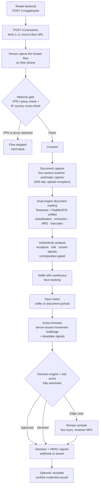

# Nova KYC

**Identity verification infrastructure by [Nova Inc](https://novamail.store).**

Nova KYC lets a business confirm that a person is who they claim to be —
before that business gives them an account, money, or access. A tenant
creates a verification session through the API, sends the person to a
hosted, phone-first verification flow, and receives a fully automatic
decision — approved, declined, or routed to human review — backed by
document forensics, dual-engine document reading, biometric face
matching, active liveness, and a risk engine.

The platform is **complete and live in production**. It is an original
build: our code, our design, our rules — informed by what the identity
category does, copying none of it.

| | |
|---|---|
| **Product** | https://kyc.novamail.store |
| **Developer portal** | https://kyc.novamail.store/docs |
| **OpenAPI 3.1 specification** | https://kyc.novamail.store/openapi.json · https://kyc.novamail.store/openapi.yaml |
| **Tenant dashboard** | https://kyc.novamail.store/dashboard |
| **Review console** | https://kyc.novamail.store/console |
| **Complete developer guide** | [docs/DEVELOPER.md](docs/DEVELOPER.md) |
| **Status** | Production — live, complete platform |

> **How to read this repository.** Everything this README claims is
> implemented in the code in this repository and, where a number is
> quoted, measured by a benchmark recorded under
> [benchmarks/](benchmarks/). Where a capability has a boundary — a
> registry that needs partner credentials, a signal that is
> evidence-only — the boundary is stated in plain language, here and
> in the product itself. Claims are audited against the code
> ([docs/CLAIMS-AUDIT.md](docs/CLAIMS-AUDIT.md)).

---

## Who it is for

- **Fintechs and payment platforms** onboarding customers under KYC/AML
  obligations.
- **Marketplaces and platforms** that must verify sellers, drivers,
  hosts, or agents before granting earning or access privileges.
- **Any product** — web or mobile — that needs a defensible answer to
  "is this person who they say they are?" without building document
  forensics, biometrics, and review operations in-house.

Nova KYC is Nova Inc's own verification layer first — it serves Nova's
products — and is built to the standard an external tenant would
demand: tenant isolation, signed webhooks, audited review, encrypted
media, and measured accuracy.

---

## How a verification works



### The journey, step by step

1. **The tenant creates an applicant** (`POST /v1/applicants`). Two
   identity models are supported: *document-sourced* (recommended —
   the document is the source of truth; the platform reads the name,
   date of birth, and document number from the document itself) and
   *declared* (the tenant supplies name and date of birth, and the
   platform cross-checks the document against them).
2. **The tenant creates a session** (`POST /v1/sessions`) at
   verification Level 1, 2, or 3 and receives a one-session flow URL.
   Sessions are resumable: reopening an unexpired link continues where
   the person left off.
3. **The person opens the link on their phone.** The hosted flow is
   phone-only by design (a desktop visit is handed a QR code to
   continue on a phone). Before anything is captured, the platform
   checks the network: a detected VPN or proxy **hard-blocks** the
   flow, and the IP-derived country is cross-checked against the
   document's country.
4. **Consent** is captured in the flow, with voice guidance throughout
   — spoken, human-sounding prompts coach the person at every step.
5. **The document is captured by a live camera scanner.** There is no
   gallery or file-upload path in the standard flow. The scanner sees
   the document before it may capture: a real-time detector locks onto
   the document's outline and geometry, quality judges (light, glare,
   sharpness, stillness) must hold for a stability window, and then
   the scanner **captures by itself — there is no shutter button**. A
   two-sided document automatically prompts for the back. The single
   exception is the Nigerian NIN slip, a paper printout that is
   routinely folded or laminated: it may be uploaded as a photo, and
   the typed NIN the person supplies must tally exactly with the
   number read off the slip.
6. **The document is read by two OCR engines at once** — Tesseract and
   PaddleOCR — merged into one word stream with cross-engine
   arbitration (see *Advanced capabilities*). The read drives template
   classification against per-country document templates, field
   extraction, MRZ reading with ICAO check digits, and barcode /
   PDF417 decoding with AAMVA payload cross-checks against the printed
   data.
7. **Authenticity is analysed forensically**: error-level analysis,
   file metadata, moiré and pixel-grid screen signatures, gloss,
   colour gamut, portrait-region integrity, font consistency,
   compositing and border edges, and security-pattern presence. A
   hard authenticity failure requires corroboration across independent
   signal families — one noisy signal never convicts a document.
8. **The person takes a live selfie.** The face is tracked
   continuously from the camera stream, with identity continuity
   enforced across frames; the track's median embedding is matched
   against the document portrait (YuNet detection + SFace embeddings).
9. **Liveness is proven actively.** The server issues a randomised
   two-movement challenge (for example, turn left, then look up) that
   must be performed live on camera; a recorded replay cannot know the
   fresh challenge. Deepfake and presentation-attack signals —
   including an rPPG pulse leg that is honestly labelled evidence-only
   — are evaluated alongside.
10. **The decision engine decides automatically.** Every check's
    outcome feeds an explainable risk score; the standard path ends in
    an automatic **approved** or **declined** decision with recorded
    reason codes — no human in the loop. Only defined exceptions route
    to the review console: tenant-required review, top-level screening
    hits, business verification, and platform errors.
11. **The tenant is notified by HMAC-signed webhook**
    (`session.completed`, `case.decided`, and related events) with
    retry, dead-letter, and operator replay; the full result is always
    retrievable from the API. Reviewers work edge cases in the console
    under four-eyes control with TOTP MFA.
12. **A reusable verified credential** can be issued from an approved
    session — an HMAC-signed, claims-only attestation a tenant can
    verify later without re-running verification. It never contains
    document images or raw biometric data.

---

## Platform capabilities

### Tenants, keys, and configuration

| Capability | What it does |
|---|---|
| Tenant accounts | Operator-provisioned tenants (there is no public self-service signup). Tenant creation requires the platform operator token and fails closed without it. |
| API keys | Separate **test** and **live** keys per tenant; sessions are environment-scoped to the key that created them. Keys can be listed and revoked. Test keys run the real pipeline — there is no fake-outcome sandbox. |
| Per-tenant flow config | Versioned configuration per tenant, environment, and level: required checks, face-match threshold and margin, risk auto-approve ceiling, proof-of-address window, screening threshold, case SLA, four-eyes on/off. Every decision records the config version it used. |
| Dashboard | Tenant self-service at [/dashboard](https://kyc.novamail.store/dashboard): usage, invoices, webhook endpoints, recent sessions. |

### The hosted verification flow

- **Phone-first, voice-guided.** Pre-rendered human-sounding voice
  prompts coach the applicant through consent, document capture,
  selfie, and liveness; the flow is resumable and remembers completed
  steps.
- **Live camera scanner only.** Detection-gated automatic capture (no
  shutter button), per-document-type geometry (rigid cards, passport
  pages, paper printouts, booklet pages each modelled correctly),
  automatic back-side capture for two-sided documents, zoom and
  four-corner framing guidance, and a document-quality report (blur,
  glare, darkness) computed on every read.
- **Network gate.** VPN/proxy hard block before capture, IP-country
  vs document-country consistency as a risk input, device timezone
  cross-check.

### Document intelligence

- **Classification** against per-country layout templates: issuer
  labels, portrait position, aspect, and structural elements are
  scored; a claim whose country anchor is absent is capped below the
  pass line unless a check-digit-valid MRZ names the claimed country.
  A document stays valid until its printed expiry even when the
  issuing authority changes its design — verdicts rest on originality
  forensics, expiry, and data consistency, never on design generation.
- **Dual-engine OCR** (detailed under *Advanced capabilities*):
  Tesseract and PaddleOCR read every document; their word streams are
  merged and arbitrated before extraction.
- **Field extraction** per document type: label-anchored and
  zone-based reads (including local-language labels and AAMVA numbered
  labels on US documents), per-type number-format validators, and
  checksum validation where the format carries one (ICAO MRZ check
  digits, Verhoeff, NRIC).
- **Machine-readable cross-checks.** MRZ ↔ printed-data consistency;
  QR / PDF417 / Code 128 decoding with payload parsing — AAMVA
  payloads on North American documents are parsed in full and
  cross-checked field-by-field against the printed face, so a genuine
  front paired with the wrong back fails.
- **Expiry and age logic that respects the document.** Document types
  that print no expiry (Nigerian voter's card, NIN card, NIN slip,
  Aadhaar, PAN, and others in the registry) are never failed for a
  missing expiry; types that print no date of birth are never failed
  for a missing DOB. A registry-level validity window is enforced
  where a type itself expires (for example, South Africa's green ID
  book after 2028-03-31).

### Authenticity and fraud defence

- **Forensic signal pack**: error-level analysis, editing-software
  metadata, moiré / pixel-grid / gloss / gamut screen signatures,
  portrait-region splice analysis, font consistency, compositing
  edges, border edges, and security-pattern presence — combined under
  the corroboration rule described below.
- **Screen and recapture detection**: a document photographed off a
  screen, or a print of a photo, is caught by the screen-signal family
  and the flow's own refresh-banding watch during capture.
- **Fraud intelligence**: an HMAC-hashed duplicate index over document
  numbers and face embeddings flags the same document or face
  appearing across sessions; velocity and coordination signals route
  to review — they never auto-reject on their own.
- **Sanctions screening** against loaded lists (the OFAC SDN list is
  fetchable with the shipped tooling); with no list loaded, screening
  reports an error — never a silent pass. Hits are dispositioned by
  reviewers.
- **Risk engine**: every check contributes explainable points to a
  session risk score and band; auto-approval is only possible below a
  tenant-configured low-risk ceiling.

### Biometrics

- **Face match**: YuNet detection + SFace embeddings; the operating
  threshold (cosine 0.363) is not a library default taken on faith —
  it is the point measured on the full LFW protocol (see *Measured
  evidence*), and tenants can configure a stricter threshold.
- **Continuous face tracking**: the face must be present and remain
  the *same* face across the selfie burst and the liveness recording;
  an identity break fails the track.
- **Active liveness**: server-issued randomised movement challenges,
  analysed server-side. Presentation-attack decision logic is
  evaluated under ISO/IEC 30107-3 metric definitions (see PAD
  evaluation under *Measured evidence*).
- **Deepfake signals**: rPPG pulse analysis (POS + CHROM + green legs
  under a signal-quality gate), face-region frequency artefacts,
  motion trajectory, and client device signals — combined as evidence,
  with the pulse leg labelled evidence-only at current clip lengths.

### Review, KYB, and credentials

- **Review console** with case queues, SLAs, an evidence pre-read, and
  audited access to protected media. Privileged actions require
  reviewer TOTP MFA (RFC 6238, replay-protected).
- **Four-eyes rule**: overturning an engine rejection requires a
  second reviewer to confirm.
- **KYB business verification**: business records, directors and
  beneficial owners (director / UBO roles), evidence document upload,
  a registry-check step, a reviewer registry decision, and a criteria
  evaluation. The registry-check step uses an adapter that **fails
  closed as `not_configured`** until partner registry credentials are
  supplied for that country — it is format validation plus reviewer
  confirmation today, and is labelled that way everywhere; it is not
  represented as a live government-registry connection.
- **Reusable verified credentials**: HMAC-signed, claims-only
  credentials issued from approved sessions; verifiable and revocable
  through the API; they carry no images or raw biometrics.
- **Ongoing monitoring**: approved applicants can be re-screened;
  new screening hits raise monitoring alerts and webhook events.

### Platform operations

- **Webhooks**: five implemented events — `session.completed`,
  `case.opened`, `case.decided`, `applicant.deleted`,
  `screening.hit_new` — delivered with an HMAC-SHA256 signature header
  over the raw body, exponential-backoff retries, a dead-letter state,
  and operator replay. Delivery targets pass an SSRF guard that
  refuses non-public addresses before any network call.
- **Usage and billing machinery**: exactly-once usage metering,
  versioned price books, invoices, and tenant quotas. **Prices are
  operator-set**; the machinery is complete, the commercial price list
  is an operator decision.
- **Retention and erasure**: configurable retention sweeps delete the
  media of old decided sessions; applicant erasure is supported
  through the API and audited.
- **Audit log**: tenant, reviewer, and system actions are recorded,
  including privileged media access.

---

## Verification levels

Levels are configuration-driven; the built-in defaults are:

| Level | Required checks (defaults) | Typical use |
|---|---|---|
| **1** | Capture quality, document framing, document classification, data consistency, OCR, expiry/age, consistency | Document identity core |
| **2** | Level 1 **plus** MRZ (where the document carries one), authenticity, face match, continuous face track, liveness, deepfake | Full person verification |
| **3** | Level 2 **plus** proof of address, sanctions screening | Enhanced verification |

The hosted experience always includes consent and a live selfie;
liveness is presented from Level 2 and proof of address at Level 3.
The VPN/proxy gate and IP-country cross-check are platform controls
that wrap every level.

---

## Supported countries and documents

Nova KYC launches with **16 countries**. Passports are supported for
every launch country; non-launch countries are rejected at session
creation. The registry below is the platform's real document registry
(`server/docregistry.py`) — every type listed is validated, prompted,
and expiry-checked according to its own facts.

| Country | Documents supported |
|---|---|
| **United States** | Passport · Passport card · Driver's license · State ID |
| Canada | Passport · Driver's licence · Provincial photo card |
| United Kingdom | Passport · Driver's licence · PASS proof-of-age card |
| Nigeria | Passport · Driver's licence · National ID · Voter's card (INEC PVC) · NIN card · NIN slip |
| Ghana | Passport · Driver's licence · Ghana Card (national ID) · Voter ID card |
| Kenya | Passport · National ID (2nd generation) · Maisha Card (3rd generation) · Smart driving licence |
| South Africa | Passport · Smart ID card · Green ID book · Driving licence card |
| India | Passport · Aadhaar · PAN card · Driver's licence · Voter ID (EPIC) |
| Philippines | Passport · PhilID (national ID) · UMID · Driver's license |
| Singapore | Passport · NRIC · Driving licence |
| United Arab Emirates | Passport · Emirates ID · Driver's licence |
| Australia | Passport · Driver's licence · State photo card |
| Germany | Passport · Driver's licence · National ID (Personalausweis) |
| France | Passport · National ID card (CNI) · Driver's licence |
| Netherlands | Passport · National ID (identiteitskaart) · Driver's licence (rijbewijs) |
| Ireland | Passport · Passport card · Driver's licence · National Age Card |

Registry facts worth knowing:

- **Nigeria's NIN slip prints no date of birth and no expiry** — the
  platform never fails it on either; the slip is also the one document
  type with an upload path (with the typed-NIN tally check), because
  it is a paper printout rather than a card.
- Several types print **no expiry** (Nigerian voter's card and NIN
  card, Aadhaar, PAN, Kenyan 2nd-generation ID, Singapore NRIC, South
  African Smart ID, Irish Age Card, and more) and are modelled that
  way — a missing expiry on those documents is correct, not a defect.
- Document generations are equally valid: an older design that is
  still within its printed validity is verified on its forensics and
  data, not marked down for being an older design.

---

## Advanced capabilities

### One unified dual-engine reading brain

Most platforms read a document with a single OCR engine and inherit
that engine's blind spots. Nova KYC runs **two independent engines —
Tesseract and PaddleOCR (PP-OCRv5) — as one reading family**:

- Both engines read the same document in parallel; their word streams
  are **merged into a single stream**: a token both engines see in the
  same place becomes one high-confidence token; where they disagree,
  the higher-confidence reading holds the place and the rival reading
  still reaches the extraction brain as testimony.
- Extraction consumes the merged stream. Where the identity fields are
  still incomplete, each engine's own extraction testifies and an
  **arbitration layer** adopts union finds with recorded provenance
  (both-engines / single-engine / arbitrated).
- A **conflicting document number is adopted from neither engine** —
  downstream arbiters (the typed NIN claim, the MRZ, the barcode
  payload) decide it. Every cross-engine disagreement is recorded on
  the read and surfaced in the API.
- The measured result is under *Measured evidence*: the unified reader
  extracted **31 of 43** applicable identity fields across the
  labelled real-sample set, against 25/43 and 26/43 for the individual
  engines — and was never below the best single engine on any case.

### Fail-closed by design

The platform's security posture is that **unknown is never a pass**:

- Missing models, missing OCR, a missing screening list, an
  unconfigured registry adapter, or an unconfigured external provider
  slot each produce an explicit error or `not_configured` state —
  never a silent pass and never a fabricated result.
- Tenant creation is disabled entirely when the operator token is not
  configured.
- A document portrait that cannot be found returns face match
  *unclear* — it blocks auto-approval rather than guessing.
- Webhook delivery refuses non-public targets before any network
  call; reviewer recovery fails closed to an audited admin reset.

### Corroboration-gated authenticity

Phone photos of genuine documents are noisy: compression analysis and
font-consistency signals fire on perfectly real cards. Nova KYC's
authenticity verdict therefore requires **corroboration**: a hard fail
needs both a high signal score **and** at least two independent
non-edit signal families (screen, provenance, portrait, structure, or
data) at moderate strength or above. Edit-family signals alone can
raise suspicion but cannot convict. This rule was derived from a
signal census over the genuine-document corpus and is measured in
[benchmarks/RECALIBRATION-EVAL.md](benchmarks/RECALIBRATION-EVAL.md).

### Evaluation as a shipped discipline

Accuracy claims are treated as code: benchmark harnesses ship in this
repository (`scripts/benchmark_*.py`, `scripts/pad_eval.py`), their
outputs are committed under [benchmarks/](benchmarks/), and public
claims are audited against the implementation
([docs/CLAIMS-AUDIT.md](docs/CLAIMS-AUDIT.md)).

---

## Measured evidence

All figures below are measured on this platform's own pipeline and
recorded in the linked benchmark files. Nothing is estimated; where
something could not be measured, the benchmark says so.

### Document reading — dual-engine evaluation

Labelled real-sample set, production conditions (orientation-normalised
renditions, production extraction brain). Score = applicable identity
fields extracted (surname, given names, date of birth, number, expiry;
fields a document type does not print are excluded).

| Reader | Fields extracted |
|---|---|
| Tesseract alone | 25 / 43 |
| PaddleOCR alone | 26 / 43 |
| **Unified dual-engine (production)** | **31 / 43** |

The unified reader was never below the best single engine on any of
the 11 cases, and strictly above both on three — including recovering
the complete date of birth on the Nigerian digital NIN slip, a
standing single-engine residual. Full per-case results:
[benchmarks/OCR-DUAL-EVAL.md](benchmarks/OCR-DUAL-EVAL.md).

On a synthetic, template-conformant corpus (144 documents across 12
document types, with named degradations), field extraction scored
exact-match **1.0000** on clean documents and **0.9554** across all
degradation levels combined (mean character error rate 0.0288) —
[benchmarks/RESULTS.md](benchmarks/RESULTS.md). The corpus is
synthetic by design; it bounds the extraction wiring, and the
real-sample evaluation above is the field-reading evidence.

### Face match — full LFW protocol

The production pipeline (YuNet + SFace through the production adapter)
was benchmarked on the complete Labeled Faces in the Wild View-2
protocol — all **6,000 official pairs**, no subsampling:

| Measure | Value |
|---|---|
| Equal error rate | **1.07%** (at threshold 0.288) |
| At the production threshold 0.363 | **FAR 0.10% · FRR 2.00% · accuracy 98.95%** |
| Standard protocol accuracy | 99.13% ± 0.38% |
| High-assurance option (0.413, tenant-configurable) | FAR 0.00% (0/3,000) · FRR 3.33% |

The shipped 0.363 threshold was **kept on this measured evidence**, not
on a library default. Honest limits, recorded in the benchmark:
funneled LFW faces are pre-cropped, so its zero detection-failure rate
does not transfer to raw phone media; demographic slicing is
**unmeasured** because LFW carries no demographic attributes.
[benchmarks/BIOMETRICS.md](benchmarks/BIOMETRICS.md)

### Presentation-attack (liveness) evaluation

Production liveness decision logic, ISO/IEC 30107-3 metric definitions,
synthetic feature-level battery (40 trials per attack class):

| Metric | Value |
|---|---|
| APCER (overall) | **0.0%** |
| APCER by class (static photo / face absent / partial replay) | 0.0% each |
| BPCER (reject) | **0.0%** |
| BPCER (non-pass, incl. unclear) | 2.5% |
| ACER | **0.0%** |

On real artefacts, the owner's genuine liveness videos replayed
verbatim against fresh server challenges passed **0 of 6** evaluations
— challenge freshness alone defeats a bit-perfect replay. Stated
plainly in the benchmark: this is a readiness evaluation of the
production logic, **not** an iBeta / ISO 30107-3 laboratory
certification, and no video-level PAD metric or certification is
claimed. Physical-mask and DNN face-swap corpora are unmeasured.
[benchmarks/PAD-EVAL.md](benchmarks/PAD-EVAL.md) ·
[benchmarks/BIOMETRICS.md](benchmarks/BIOMETRICS.md)

### Forgery battery

A labelled fake California ID card (a faithful visual copy that
**passed** template classification at 85.6, level with the genuine
control) was **caught by the forensic authenticity layer** —
recapture/edit and altered-text reason codes — while the genuine
control was not rejected. [benchmarks/FAKE-BATTERY.md](benchmarks/FAKE-BATTERY.md)

After recalibration, the authenticity and classification gate over the
recorded corpus stands at: **14 of 14 genuine documents pass/unclear
(0 violations)**, the labelled fake still fails, and all subject cards
unclear — with the same evaluation recording its own named residuals
rather than tuning them away.
[benchmarks/RECALIBRATION-EVAL.md](benchmarks/RECALIBRATION-EVAL.md)

### Security verification

- Tenant-isolation battery: **9/9** scenarios pass.
- Scripted self-penetration test: **32/32** probes, 0 findings
  ([docs/PENTEST.md](docs/PENTEST.md)) — a precondition for, not a
  substitute for, an external penetration test, which has not yet been
  commissioned.
- Backup/restore drill executed and measured, with restored media
  decrypting byte-identical ([benchmarks/BACKUP-RESTORE.md](benchmarks/BACKUP-RESTORE.md)).
- The platform carries a **453-test automated suite**; a single known
  failure is environment-specific (one synthetic German fixture misread
  by this machine's Tesseract build — the misread is itself correctly
  flagged invalid by the format validator).

---

## For developers

### Quickstart

```bash
# 1. Create an applicant whose identity will be read from the document
curl -s https://kyc.novamail.store/v1/applicants \
  -H "Authorization: Bearer $KYC_TEST_KEY" \
  -H 'Content-Type: application/json' \
  -d '{"country": "NG", "identity_source": "document", "external_ref": "user_12345"}'

# 2. Create a session — the response carries the one-session flow URL
curl -s https://kyc.novamail.store/v1/sessions \
  -H "Authorization: Bearer $KYC_TEST_KEY" \
  -H 'Content-Type: application/json' \
  -d '{"applicant_id": "APPLICANT_ID", "level": 2, "expires_hours": 24}'

# 3. Send the person to https://kyc.novamail.store/flow/<flow_token>

# 4. Read the authoritative result from your backend
curl -s https://kyc.novamail.store/v1/sessions/SESSION_ID \
  -H "Authorization: Bearer $KYC_TEST_KEY"
```

With the zero-dependency JavaScript SDK ([sdk/kyc.mjs](sdk/kyc.mjs)):

```js
import { KycClient } from './sdk/kyc.mjs';

const kyc = new KycClient({
  apiKey: process.env.KYC_API_KEY,
  baseUrl: 'https://kyc.novamail.store',
});

const applicant = await kyc.createApplicant({
  country: 'NG', identitySource: 'document', externalRef: 'user_12345',
});
const session = await kyc.createSession({
  applicantId: applicant.id, level: 2, expiresHours: 24,
});
const verificationUrl = kyc.absoluteFlowUrl(session); // send this to the user
const result = await kyc.getSession(session.id);      // authoritative outcome
```

### The API contract

- **OpenAPI 3.1**: 63 paths, 69 operations, 43 schemas —
  [docs/openapi.json](docs/openapi.json) ·
  [docs/openapi.yaml](docs/openapi.yaml) · live at
  https://kyc.novamail.store/openapi.json. Import it into Postman,
  Insomnia, a client generator, or an AI agent's tool registry.
- **Live API explorer**: https://kyc.novamail.store/docs renders the
  specification with search, tag filters, and expandable operations.
- **Authentication**: tenant API key as a Bearer token for the tenant
  API; a separate platform-operator header for operator operations;
  scoped, expiring flow tokens for the hosted flow.
- **SDK**: the JavaScript SDK exposes the full tenant surface —
  applicants, sessions and checks, keys, reviewer users and MFA,
  cases, protected media, KYB, webhooks and delivery replay,
  credentials, monitoring, usage and invoices, and configuration —
  with webhook signature verification built in.
- **Complete guide**: [docs/DEVELOPER.md](docs/DEVELOPER.md) covers the
  integration model, environments and keys, identity models, levels,
  lifecycle and polling rules, webhooks, review operations, KYB,
  errors and retries, a security checklist, testing, and
  troubleshooting. [docs/INTEGRATION.md](docs/INTEGRATION.md) is the
  short quickstart; [docs/API.md](docs/API.md) is the endpoint
  reference companion to the OpenAPI file.

### Integration patterns

| Channel | Pattern |
|---|---|
| **Website** | Create the session server-side; navigate the user to the flow URL (full-page) or open it in a new tab and poll session status when focus returns. Desktop visitors are handed a QR code to continue on their phone — the flow is phone-only. |
| **Mobile app** | Create the session from your backend (never embed the API key in the app); open the flow URL in the system browser, SFSafariViewController, or a Chrome Custom Tab; on app resume, refresh the result from your backend, and/or receive the webhook server-to-server. |
| **AI agents** | Import the OpenAPI specification as the tool contract. Agents create applicants and sessions, hand the flow URL to the human, and read decisions — capture always happens in the hosted flow, never through the API. Keys stay in the agent host's secret store, never in prompts or tool arguments beyond the call itself. |

Stated plainly, because integrators plan around them: there is **no
iframe/embed SDK, no native capture SDK, no session `return_url`, and
no API-only media upload** today. The hosted-flow handoff above is the
supported contract. `Idempotency-Key` headers are not honoured;
session creation is safe to retry by listing sessions.

---

## Architecture

Nova KYC is a deliberately local-first system: one Python service owns
the API, the hosted flow, and every verification pipeline, with all
state on the operator's infrastructure — no third-party verification
vendor sits in the decision path.

| Layer | Implementation |
|---|---|
| Service | Python 3.12 (standard library HTTP core), single deployable service |
| Data | SQLite with tenant-scoped rows on every table; isolation enforced in application code and proven by the isolation battery |
| Media storage | Local encrypted object store — AES-256-GCM envelope encryption, master key held in an environment/file secret, never in the database or the repository; a sealed, passphrase-encrypted key backup ships with the deployment |
| Document vision | OpenCV framing and quality analysis; Tesseract + PaddleOCR (PP-OCRv5) dual-engine reading; zxing barcode decoding with OpenCV fallback arms |
| Biometrics | YuNet face detection + SFace embeddings (OpenCV Zoo models), continuous tracking, active-challenge liveness |
| Delivery | The public site is served through Cloudflare (tunnel + Worker relay) in front of the origin service; the API contract is hosting-independent ([docs/CLOUDFLARE-ARCHITECTURE.md](docs/CLOUDFLARE-ARCHITECTURE.md)) |
| Operations | systemd services, a health watchdog with automatic recovery, checksummed backups with a measured restore drill, and an operator runbook ([docs/RUNBOOK.md](docs/RUNBOOK.md)) |

---

## Security and privacy

- **Tenant isolation** on every query, proven by a dedicated
  cross-tenant battery (reads and writes, 9/9).
- **Encryption at rest** for all stored verification media
  (AES-256-GCM); reads fail closed without the master key.
- **Reviewer MFA**: TOTP (RFC 6238, replay-protected) gates privileged
  reviewer actions; four-eyes confirmation for overturning engine
  rejections; all privileged media access is audited.
- **Webhook security**: HMAC-SHA256 signatures over the raw body with
  timestamp staleness checks; SSRF guard refuses non-public delivery
  targets.
- **Rate limits** per API key, per flow token, and per IP, with real
  `429` responses and `Retry-After`; request-body caps return `413`.
- **Fail-closed defaults** throughout (see *Advanced capabilities*).
- **Privacy by design**: webhooks and reusable credentials carry
  claims and outcomes only — never document images or raw biometric
  data. Retention sweeps and API-driven applicant erasure bound how
  long personal data lives on the platform.
- **Honest residual list**: the SQLite database file itself is not
  encrypted (media files are; the database relies on host controls);
  captures are type-checked but not malware-scanned; no external
  penetration test has been commissioned yet. The full readiness
  mapping is in [docs/SOC2-READINESS.md](docs/SOC2-READINESS.md) — a
  readiness map, not a certification; **no SOC 2, iBeta, or ISO
  certification is held or claimed**.

---

## Run it locally

```bash
python3 scripts/fetch_models.py     # one-time: face + OCR support models into models/
python3 -m server --port 8765       # data lives in ./data/
# Landing:   http://127.0.0.1:8765/
# Console:   http://127.0.0.1:8765/console   (paste a tenant API key)
# Dashboard: http://127.0.0.1:8765/dashboard
# Docs:      http://127.0.0.1:8765/docs

python3 -m unittest discover -s tests        # the automated suite
python3 scripts/e2e_local.py                 # end-to-end verification run
python3 scripts/fetch_ofac.py                # optional: OFAC SDN list into data/lists/
python3 -m server.retention --days 90        # delete media of old decided sessions
```

Requires Python 3.12, Pillow, NumPy, OpenCV, PaddleOCR, and the
`tesseract` CLI. If Tesseract is missing, the OCR check reports an
error — it never pretends to pass. If the face models are missing,
face match and liveness report `model_missing` — never a fake pass.

Tenant creation is operator-only:

```bash
curl -s -X POST localhost:8765/v1/tenants \
  -H 'Content-Type: application/json' \
  -H 'X-Platform-Admin: <operator token>' \
  -d '{"name": "Example Tenant", "country": "NG"}'   # returns test + live keys ONCE
```

---

## Documentation and references

| Document | What it covers |
|---|---|
| [docs/DEVELOPER.md](docs/DEVELOPER.md) | The complete developer guide — integration model, website/mobile/agent patterns, webhooks, KYB, review operations, errors, testing |
| [docs/API.md](docs/API.md) | Endpoint reference companion to the OpenAPI specification |
| [docs/INTEGRATION.md](docs/INTEGRATION.md) | Short integration quickstart |
| [docs/openapi.json](docs/openapi.json) · [docs/openapi.yaml](docs/openapi.yaml) | The machine-readable API contract (OpenAPI 3.1) |
| [sdk/README.md](sdk/README.md) · [sdk/kyc.mjs](sdk/kyc.mjs) | JavaScript SDK and its method map |
| [docs/DECISIONS.md](docs/DECISIONS.md) | The platform's decision record — what was decided and why |
| [docs/CLAIMS-AUDIT.md](docs/CLAIMS-AUDIT.md) | Every public claim audited against the code |
| [docs/RUNBOOK.md](docs/RUNBOOK.md) | Operations runbook |
| [docs/CLOUDFLARE-ARCHITECTURE.md](docs/CLOUDFLARE-ARCHITECTURE.md) | Production delivery architecture |
| [docs/SOC2-READINESS.md](docs/SOC2-READINESS.md) | Control-readiness mapping (not a certification) |
| [docs/PENTEST.md](docs/PENTEST.md) | Scripted self-penetration test results |
| [benchmarks/OCR-DUAL-EVAL.md](benchmarks/OCR-DUAL-EVAL.md) | Dual-engine OCR evaluation on real samples |
| [benchmarks/BIOMETRICS.md](benchmarks/BIOMETRICS.md) | Face-match FAR/FRR and presentation-attack measurements |
| [benchmarks/FAKE-BATTERY.md](benchmarks/FAKE-BATTERY.md) | Labelled forgery battery |
| [benchmarks/RECALIBRATION-EVAL.md](benchmarks/RECALIBRATION-EVAL.md) | Authenticity/classification recalibration gate |
| [benchmarks/PAD-EVAL.md](benchmarks/PAD-EVAL.md) | Liveness (PAD) evaluation under ISO/IEC 30107-3 definitions |
| [benchmarks/RESULTS.md](benchmarks/RESULTS.md) | Field-extraction benchmark on the synthetic corpus |
| [research/specimens/INDEX.md](research/specimens/INDEX.md) | Researched document specimens behind the registry and templates |

---

## Boundaries, stated plainly

- Registry checks for business verification require partner
  credentials per country and fail closed (`not_configured`) until
  configured; KYB today is format validation, evidence, and reviewer
  confirmation, labelled as such.
- Sanctions screening covers the lists actually loaded (OFAC SDN
  ships as a fetchable list); no list loaded means screening errors,
  never a pass.
- External biometric provider slots exist behind an adapter and fail
  closed until an operator supplies vendor credentials; the shipped,
  measured pipeline is Nova KYC's own YuNet + SFace stack.
- Commercial pricing is operator-set; the metering, invoicing, and
  quota machinery is built and live.
- No certification (SOC 2, iBeta, ISO) is held or claimed.

---

## About

**Nova KYC is a product of Nova Inc** — the company behind Nova
Payments, the Agent Exchange, and the Nova ecosystem at
[novamail.store](https://novamail.store). One company, one account
model, one verification layer across the ecosystem.

- Product: https://kyc.novamail.store
- Developers: https://kyc.novamail.store/docs
- Company: https://novamail.store
